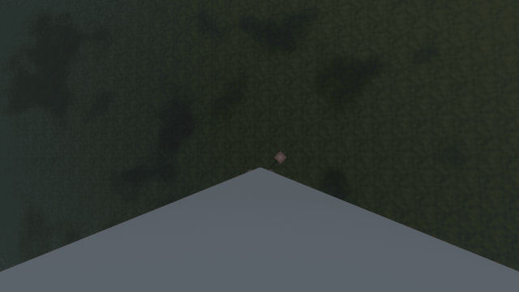
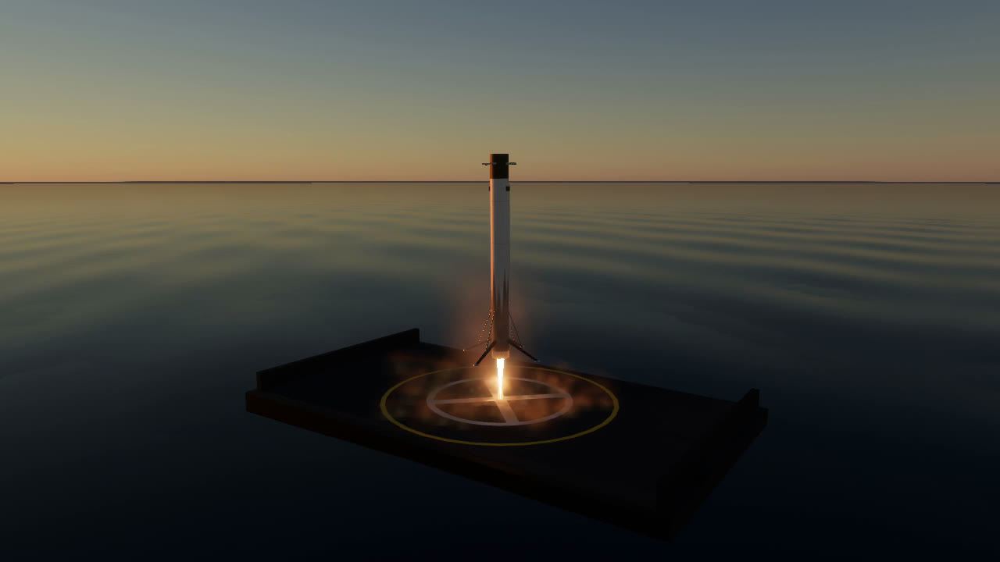
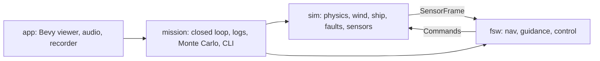

# Rocket Lander

A Falcon-style booster return, to a landing pad or a drone ship at sea, simulated in Rust:
6-DOF physics with a standard atmosphere and wind, flight software that only sees noisy
sensors (Kalman filter navigation, G-FOLD convex landing guidance, model-predictive
terminal guidance, LQR attitude control), a headless Monte Carlo runner, and a Bevy
mission-control viewer with live telemetry, replay, onboard cameras, sound and video
export.



## What it does

- **Physics** (`crates/sim`): a 40 m booster with engines, gimbal, grid fins, cold-gas
  thrusters, shock-absorbing legs and a center of mass that rises as it burns propellant;
  the 1976 US Standard Atmosphere, wind with shear and gusts, base-first aerodynamics with
  transonic drag rise, contact with the ground or a heaving drone ship, and
  IMU/GPS/altimeter/star-tracker sensors.
  Monte Carlo dispersions randomize the vehicle and the weather; a stress level adds harsher
  weather and faults: an engine failure in the entry burn, GPS outages, accelerometer
  bias jumps and a sluggish throttle.
- **Flight software** (`crates/fsw`), which never sees the true state:
  - Navigation: an 11-state Kalman filter (position, velocity, accelerometer bias and the
    wind aloft), with the wind read from the side force the body feels.
  - Guidance: boostback and entry burns aimed by a landing-point predictor, aerodynamic
    steering on the way down, then a G-FOLD landing burn re-planned every half second with
    Clarabel. Over the last 200 m a model-predictive controller plans the tilt for an
    upright touchdown without sideways speed, and at sea the final meters follow the
    deck's heave.
  - Control: a discrete LQR per axis that models how the gimbal and fins lag their
    commands, allocated across the gimbal, grid fins and thrusters.
- **Mission** (`crates/mission`): the closed loop, flight logs, landing judgement, and the
  `lander` CLI for single flights, Monte Carlo batches and stress sweeps.
- **Viewer** (`crates/app`): Bevy 0.20 with a physically based sky, a time-of-day sun
  with night lighting, engine plumes and smoke, the drone ship in a moving swell, onboard
  and pad cameras with an automatic director, engine sound delayed by the speed of sound
  with sonic booms, egui telemetry plots, replay, and video export with the soundtrack.

## Results

Monte Carlo with randomized vehicle, wind and starting state (`lander mc`, 300 runs):

| Scenario | Landed | Miss (mean / p95) |
|---|---|---|
| Landing (from 5 km) | 100% | 1.9 / 5.5 m |
| Full return (from stage separation at 70 km) | 100% | 2.0 / 5.3 m |
| Drone ship (140 km downrange, in a swell) | 99.7% | 1.0 / 2.8 m |

And as conditions get harsher (`lander sweep`, 200 runs per level; at stress 1 about one
flight in two meets an engine failure, a GPS outage or a sensor fault, and the sea runs
twice as high):

| Stress | 0 | 0.5 | 1 | 1.5 | 2 |
|---|---|---|---|---|---|
| Landing | 100% | 100% | 97.5% | 88.5% | 70.0% |
| Full return | 100% | 99.5% | 98.0% | 90.0% | 73.5% |
| Drone ship | 99.5% | 97.0% | 97.0% | 88.0% | 48.5% |



## Running

```bash
cargo run --release -p app                                      # viewer
cargo run --release -p mission --bin lander -- fly full         # one flight's timeline
cargo run --release -p mission --bin lander -- mc landing --runs 300
cargo run --release -p mission --bin lander -- sweep full --runs 200
cargo run --release -p mission --bin lander -- mc ship --runs 100        # drone ship
cargo run --release -p app -- --record out.mp4 landing --camera auto --hour 20   # video (needs ffmpeg)
cargo test --workspace
```

In the viewer: drag to orbit, scroll to zoom; pick the scenario, seed, dispersion and
stress at the bottom, switch cameras, scrub the timeline, move the sun, and open the
Monte Carlo window to run a batch and replay its failures.

## Layout



[REFERENCE.md](REFERENCE.md) is the full technical reference: models, interfaces,
invariants, tests and measured performance.
