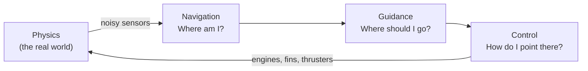

# Rocket Lander

A simulator of a reusable rocket booster flying itself back to Earth and landing
upright, on a landing pad or on a drone ship at sea, written in Rust.


The booster flies itself. Its flight software never sees the true state of the world: it
gets only noisy sensor readings, as a real flight computer does, while a separate physics
simulation decides what actually happens. Every flight brings different wind, a slightly
different rocket and starting point, and sometimes a failed engine or a GPS dropout.

**[How the booster lands](docs/how-it-works.md)** · **[Drone-ship landing with sound](docs/drone-ship.mp4)** (48 s video)

## The mission



1. **Flip.** After stage separation at 70 km, cold-gas thrusters turn the booster around.
2. **Boostback.** Three engines push it back toward the landing site.
3. **Entry burn.** Three engines slow it down before the thick lower atmosphere.
4. **Descent.** It falls engines-first, steering with its grid fins and body.
5. **Landing burn.** One engine relights. Even at minimum throttle it pushes harder than
   the nearly empty booster weighs, so it cannot hover: it has to reach zero speed
   exactly at the ground.

At sea, the drone ship waits 140 km downrange, near where the booster would fall anyway,
so only a short boostback is needed. Its deck heaves with the swell, so the
booster predicts the deck's motion and times its touchdown for when the deck is level.


## How it works

The flight software runs a classic guidance, navigation and control (GNC) loop 50 times a
second, while the physics runs at 500 Hz:



| Part | What it does | Method |
|---|---|---|
| Navigation | Blends IMU, GPS, altimeter and star tracker into a best estimate of position, velocity, attitude and even the wind | Kalman filters |
| Guidance | Plans the most fuel-efficient landing burn and re-plans it every half second | Convex optimization (G-FOLD) |
| Final approach | Over the last 700 m, plans the lean so the booster touches down upright with no sideways speed | Model-predictive control |
| Control | Turns "point here" into engine gimbal, grid fin and thruster commands | LQR |

[How the booster lands](docs/how-it-works.md) walks through each part with figures.

## Results

Each scenario flown 300 times with randomized wind, vehicle and starting point:

| Scenario | Landed | Average miss | 95% of landings within |
|---|---|---|---|
| Final descent (from 5 km) | 100% | 1.6 m | 4.9 m |
| Full return (from 70 km) | 100% | 1.9 m | 5.9 m |
| Drone ship at sea | 100% | 1.0 m | 2.2 m |

Then the conditions get worse. A stress level adds stronger wind, rougher seas and
faults: engine failures, GPS outages and sensor errors. At stress 1, about half of all
flights meet a fault, and 98–99% still land.


## Inspired by Falcon 9

It follows Falcon 9's flight sequence, actuators and constraints: three engines for
boostback and entry, one for landing, grid fins, cold-gas thrusters, no hovering, and
convex-optimization landing guidance, an approach SpaceX has described publicly.
SpaceX's flight software is not public, so the algorithms here are standard methods from
the literature, not copies of theirs. The vehicle numbers are approximate, the booster is
a rigid body (no propellant slosh or bending), and nothing is validated against real
flight data.

## Running it

Needs [Rust](https://rustup.rs). The first build takes 10–15 minutes.

```bash
cargo run --release -p app                                       # 3D viewer
cargo run --release -p mission --bin lander -- fly full          # one flight, printed as a timeline
cargo run --release -p mission --bin lander -- mc landing --runs 300   # Monte Carlo batch
cargo run --release -p mission --bin lander -- sweep full --runs 200   # landing rate vs. stress
cargo test --workspace
```

In the viewer, drag to orbit and scroll to zoom. Pick the scenario and stress at the
bottom, switch cameras, scrub the timeline, or open the Monte Carlo window to run a batch
and replay its failures. On Linux, install Bevy's system libraries first (listed in
[CI](.github/workflows/ci.yml)).

## Project layout

| Crate | Contents |
|---|---|
| `crates/sim` | The real world: rocket physics, atmosphere, wind, drone ship, sensors, faults |
| `crates/fsw` | The flight software, which sees only sensor data |
| `crates/mission` | Runs flights, judges landings, Monte Carlo, the `lander` command line |
| `crates/app` | The 3D viewer (Bevy), with sound and video export |

Every push runs the tests and a Monte Carlo gate in CI: a change that drops the landing
rate below 95% fails the build.

[REFERENCE.md](REFERENCE.md) is the full technical reference: models, interfaces,
invariants and measured performance.

## License

[MIT](LICENSE)
