# How the booster lands

This is a tour of the flight software in `crates/fsw`: what the booster knows, how it
decides where to point and how hard to push, and what made the difference in testing.
The full model and interface details are in [REFERENCE.md](../REFERENCE.md); the figures
here come from `python docs/plots.py`.

## The rules of the game

The simulation (`crates/sim`) knows everything; the flight software knows only what its
sensors tell it: an IMU, GPS, a radar altimeter, a star tracker, leg contact switches,
engine health, the cold-gas tank, and, at sea, the drone ship's reports of its deck.
It assumes the nominal vehicle. Every Monte Carlo run then gets a different real vehicle
(mass, thrust, drag, misalignment), wind, starting error and, under stress, faults.

A full return flips, burns back toward the pad, coasts over the top, relights three
engines to slow down before the thick air (the entry burn), falls through the atmosphere
steering with its body and grid fins, and relights one engine for the landing burn.

## Knowing where it is

**Translation.** A Kalman filter integrates the accelerometers and corrects with GPS and
the altimeter. It also estimates the accelerometer bias, which is how it rides out a GPS
outage on the way down.

**Attitude.** A multiplicative Kalman filter carries the attitude forward with the gyros
and corrects it with the star tracker, learning the gyro bias as it goes.

**Wind.** Nothing measures the wind directly, but the booster feels it. Whatever side
force the accelerometers report beyond what the engines and grid fins explain is the
body's lift, which gives the angle of attack and so how fast the air streams past
sideways. The Kalman filter turns that into the wind aloft, assuming the usual way wind
weakens toward the ground. From then on everything flies relative to the air.

## Deciding where to go

**Predicting the landing point.** A fast point-mass simulation of the rest of the
descent, with the same phase logic as the flight computer, says where the booster would
come down. Boostback aims that point at the pad; during the fall, zero-effort-miss
guidance leans the body to steer it with lift.

**Planning the landing burn (G-FOLD).** At ignition the flight computer solves a convex
optimization for the fuel-optimal burn to the pad: thrust within the engine's limits, a
glideslope, pointing cones, and drag as a linear term fitted at each node. The thrust
lower bound is not convex, but relaxing it with a slack variable is lossless (the optimum
lies on the bound anyway), so Clarabel solves it as a second-order cone program in
milliseconds. It re-plans every half second.

**The last few hundred meters (MPC).** The plan alone left boosters sliding: it assumed
the body tilts instantly, and the attitude takes about a second to follow. Terminal
guidance plans the tilt itself: a model-predictive controller for each horizontal axis,
whose model includes the attitude loop's lag and the body's lift as it leans across the
airflow. It aims for no sideways speed and an upright attitude at touchdown, within tilt
limits that narrow toward the ground, and re-solves every 0.1 s.

**Landing on a moving deck.** The drone ship reports its deck 0.2 s late and with noise.
Each deck motion (heave, pitch, roll) is close to one swell, so a sinusoid fitted to the
last 40 s of reports predicts it seconds ahead. Below 40 m the flight computer picks the
calmest moment it can reach (deck level and not rising), checking that the engine can fly
the approach (at minimum throttle a light booster still slows down, so it cannot dawdle),
and flies a minimum-effort profile to arrive then, square to the deck.

## Pointing and pushing

Attitude control treats each body axis as a double integrator driven through a lagging
actuator (the gimbal and fins slew at a limited rate). Gains come from a discrete LQR on
that model, tabulated over the control authority available at the moment. A torque
request is split across the engine gimbal, then the grid fins, then the cold-gas
thrusters. After an engine failure, the off-center push of the two survivors is fed
forward.

## How robust is it?

`lander sweep` flies hundreds of randomized flights at each stress level. At stress 1
about one flight in two meets an engine failure, a GPS outage or an accelerometer jump,
on top of stronger, shifting wind, a slow throttle and twice the swell.

## What did not work

Each of these looked reasonable and made the Monte Carlo worse or no better:

- Faster position tracking during the landing burn (the attitude lag turns it into
  oscillation).
- Fixing the horizontal state at the end of the G-FOLD plan.
- Assuming constant drag over the burn, or modeling it exactly per node (the conservative
  fit was more robust).
- Stiffer attitude gains, even with the actuator lag modeled.
- Starting terminal guidance higher before its model knew about aerodynamic lift.
